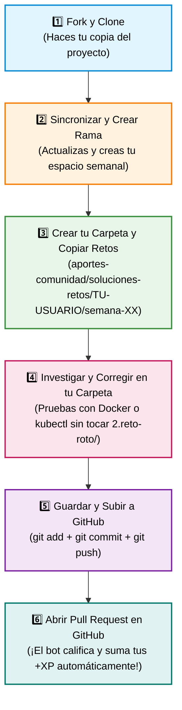

# 🤝 Aportes de la Comunidad — Cloud Native Medellín

Este espacio está reservado para el trabajo, soluciones y contribuciones de todos los asistentes del workshop **De Cero a Capitán en Kubernetes**.

---

## 📂 ¿Qué encuentras aquí?

* [**🏆 Soluciones de Retos (`./soluciones-retos/`)**](./soluciones-retos/): Las entregas de los miembros a los **"Retos Rotos"** semanales, organizadas por usuario de GitHub y por semana (`semana-00`, `semana-01`, etc.).
* [**🧰 Cheatsheets (`./cheatsheets/`)**](./cheatsheets/): Atajos de terminal, alias de `kubectl`, comandos salvavidas y apuntes compartidos por la comunidad.

---

## 🧭 Manual Paso a Paso para la Comunidad: Cómo Resolver y Entregar tus Retos

Si estás dando tus primeros pasos con **Git**, **GitHub** o la **Terminal**, ¡estás en el lugar indicado! Sigue este manual en orden y en pocos minutos tendrás tus retos listos y tu **Pull Request** enviado para ganar puntos (**+XP**) en el [Muro de Asistentes (`ASISTENTES.md`)](../ASISTENTES.md).



---

### ⚠️ La Regla de Oro Antes de Empezar

> [!IMPORTANT]
> **¡NUNCA modifiques ni borres los archivos originales dentro de `semana-XX-.../2.reto-roto/`!**  
> Esos archivos son los ejercicios base para todos tus compañeros.  
> **Siempre debes copiar los archivos a tu propia carpeta personal** dentro de `aportes-comunidad/soluciones-retos/TU-USUARIO/semana-XX/` y arreglarlos allí.

---

### Paso 1: Haz tu copia en GitHub ("Fork") y descárgala
*(Si ya hiciste esto la primera semana, salta directamente al **Paso 2**).*

1. Entra en tu navegador a [**edwinbermudez91/Fundamentos-Kubernetes**](https://github.com/edwinbermudez91/Fundamentos-Kubernetes).
2. Arriba a la derecha, haz clic en el botón **Fork** y luego en **Create fork**. Esto crea una copia del proyecto en tu cuenta de GitHub.
3. Abre la **Terminal** en tu computador (o en VS Code con `` Ctrl + ` ``) y descarga tu copia (reemplaza `TU-USUARIO` por tu usuario real de GitHub, sin `@`):
   ```bash
   git clone https://github.com/TU-USUARIO/Fundamentos-Kubernetes.git
   cd Fundamentos-Kubernetes
   ```

---

### Paso 2: Actualiza tu proyecto y crea tu "rama" de la semana

Cada semana se publican nuevos ejercicios. Antes de empezar a trabajar, asegúrate de tener la versión más reciente:

1. Entra en tu navegador a **tu repositorio**: `https://github.com/TU-USUARIO/Fundamentos-Kubernetes`.
2. Haz clic en el botón **Sync fork** y, si aparece, en **Update branch**.
3. En tu terminal, descarga esos cambios a tu computador y crea una **rama nueva** (una línea de trabajo independiente para esta semana):
   ```bash
   # 1. Asegúrate de estar dentro de la carpeta del proyecto
   cd Fundamentos-Kubernetes

   # 2. Pásate a la rama principal y descarga lo último
   git checkout main
   git pull origin main

   # 3. Crea tu rama para la semana que vas a resolver (cambia TU-USUARIO y el número de semana)
   git checkout -b TU-USUARIO/semana-01
   ```
   *(Ejemplo: si tu usuario es `ana-dev` y vas a hacer la semana 01, escribe `git checkout -b ana-dev/semana-01`).*

---

### Paso 3: Crea tu carpeta personal y copia los retos

El robot calificador del curso busca tus respuestas exactamente en la ruta:  
`aportes-comunidad/soluciones-retos/TU-USUARIO/semana-XX/`

Ejecuta en tu terminal el bloque que corresponda a la semana que estás resolviendo (recuerda cambiar `TU-USUARIO` por tu nombre de usuario en GitHub):

#### 🐳 Si vas a resolver la Semana 00 (Docker):
```bash
# 1. Crea tu carpeta personal para la Semana 00
mkdir -p aportes-comunidad/soluciones-retos/TU-USUARIO/semana-00

# 2. Copia las carpetas de los retos rotos dentro de tu carpeta
cp -r semana-00-fundamentos-docker/2.reto-roto/0* aportes-comunidad/soluciones-retos/TU-USUARIO/semana-00/
```

#### ☸️ Si vas a resolver la Semana 01 (Kubernetes):
```bash
# 1. Crea tu carpeta personal para la Semana 01
mkdir -p aportes-comunidad/soluciones-retos/TU-USUARIO/semana-01

# 2. Copia los archivos YAML rotos dentro de tu carpeta
cp semana-01-arquitectura/2.reto-roto/*.yaml aportes-comunidad/soluciones-retos/TU-USUARIO/semana-01/
```

*(Para semanas futuras —`semana-02`, `semana-03`, etc.— el proceso es idéntico: creas la carpeta `semana-XX` y copias allí los archivos desde `semana-XX-.../2.reto-roto/`).*

> [!TIP]
> **¡Conserva los nombres originales de los archivos!**  
> No les cambies el nombre al copiarlos (por ejemplo, mantén `01-pod-con-errores.yaml`, `02-pod-crashloop.yaml`, etc.). Así el bot identificará automáticamente cada reto y te sumará **+10 XP** por cada uno.

---

### Paso 4: ¿Cómo investigar y solucionar cada reto? (Método de Diagnóstico)

Abre **VS Code** y busca en el panel izquierdo tu carpeta recién creada: `aportes-comunidad/soluciones-retos/TU-USUARIO/semana-XX/`.

Para descubrir qué tiene roto cada archivo **sin adivinar**, sigue siempre estos **4 pasos de detective**:

1. **Lee el encabezado del archivo y el `README.md` del reto:**  
   Cada archivo roto tiene pistas comentadas con `#` arriba del todo indicando cuál es el síntoma.
2. **Ejecútalo para ver el error real en vivo:**
   * En **Docker (Semana 00):** Construye y corre el contenedor (`docker build` y `docker run`).
   * En **Kubernetes (Semana 01+):** Aplica el archivo de **tu carpeta** en tu clúster:
     ```bash
     kubectl apply -f aportes-comunidad/soluciones-retos/TU-USUARIO/semana-01/NOMBRE-DEL-ARCHIVO.yaml
     ```
3. **Usa los comandos de diagnóstico para encontrar la causa raíz:**
   | ¿Qué quieres averiguar? | Comando en Docker (Semana 00) | Comando en Kubernetes (Semana 01+) |
   | :--- | :--- | :--- |
   | **Ver el estado general** (`STATUS`) | `docker ps -a` | `kubectl get pods` |
   | **Ver por qué no descarga o no agenda** (`Pending` / `ImagePullBackOff`) | `docker inspect <contenedor>` | `kubectl describe pod <nombre-pod>` *(mira la tabla `Events` al final)* |
   | **Ver por qué se apaga o crashea por dentro** (`Exited` / `CrashLoopBackOff`) | `docker logs <contenedor>` | `kubectl logs <nombre-pod>` |
   | **Consultar cómo se escribe un campo YAML** | `docker run --help` | `kubectl explain pod.spec.containers` |
4. **Edita tu archivo, documenta y vuelve a probar:**
   * Modifica el archivo dentro de **tu carpeta personal** (`aportes-comunidad/soluciones-retos/TU-USUARIO/...`) y guárdalo (`Ctrl + S` o `Cmd + S`).
   * Agrega un comentario con `#` explicando brevemente qué estaba fallando y cómo lo arreglaste.
   * Vuelve a probarlo (`kubectl replace --force -f ...` o `kubectl apply -f ...`) hasta que `kubectl get pods` muestre **`Running`** (o el contenedor de Docker funcione correctamente).

---

### Paso 5: Guarda tus cambios y súbelos a tu GitHub

Cuando hayas terminado tus retos, vuelve a la terminal y ejecuta estos comandos uno por uno:

#### 1. Verifica qué archivos cambiaste:
```bash
git status
```
* **Revisión de seguridad:** Confirma que los archivos listados estén **únicamente** dentro de `aportes-comunidad/soluciones-retos/TU-USUARIO/`.  
* *(Si por error modificaste algún archivo original en `semana-00` o `semana-01`, puedes restaurarlo a su estado original con: `git checkout -- semana-00-fundamentos-docker semana-01-arquitectura`).*

#### 2. Empaca tu carpeta de soluciones (`git add`):
```bash
git add aportes-comunidad/soluciones-retos/TU-USUARIO/
```

#### 3. Ponle un título a tu entrega (`git commit`):
```bash
git commit -m "Solución retos semana 01 - TU-USUARIO"
```

#### 4. Sube tu rama a tu cuenta de GitHub (`git push`):
```bash
git push origin TU-USUARIO/semana-01
```
*(Asegúrate de escribir el mismo nombre de rama que creaste en el Paso 2).*

---

### Paso 6: Abre tu Pull Request (PR) en GitHub para recibir tus +XP 🏆

¡Falta el último clic para enviar tu tarea al repositorio principal!

1. Entra en tu navegador a tu repositorio: `https://github.com/TU-USUARIO/Fundamentos-Kubernetes`.
2. Verás un aviso amarillo arriba con un botón verde que dice **"Compare & pull request"**. Haz clic en él.
3. Ponle un título claro, por ejemplo: `Solución retos semana 01 - @TU-USUARIO`.
4. Haz clic en el botón verde **"Create pull request"**.

🎉 **¡Misión cumplida!**  
* El bot de **Cloud Native Medellín** te dará la bienvenida en los comentarios de tu Pull Request.
* Cuando un mentor revise tu entrega y la apruebe (*Merge*), el sistema de gamificación validará tus ejercicios automáticamente, publicará tu tabla de resultados y actualizará tus puntos (**+XP**) y tu rango en [`ASISTENTES.md`](../ASISTENTES.md).

---

## ❓ Preguntas y Dudas Frecuentes de la Comunidad

<details>
<summary><b>1. ¿Puedo subir mis archivos directamente desde la página web de GitHub sin usar comandos Git?</b></summary>
<br>

¡Sí! Si tienes problemas con Git en tu terminal, puedes hacerlo desde el navegador:
1. Entra a tu Fork en GitHub (`https://github.com/TU-USUARIO/Fundamentos-Kubernetes`) y asegúrate de haberle dado clic a **Sync fork**.
2. Navega hasta la carpeta `aportes-comunidad/soluciones-retos/`.
3. Arriba a la derecha, haz clic en **Add file** → **Create new file**.
4. En la cajita del nombre del archivo arriba, escribe: `TU-USUARIO/semana-01/01-pod-con-errores.yaml` (al escribir la barra `/`, GitHub crea las carpetas automáticamente).
5. Pega el contenido de tu archivo ya corregido y probado.
6. Abajo haz clic en **Commit changes...**, elige **"Create a new branch for this commit and start a pull request"** y envía tu Pull Request.
</details>

<details>
<summary><b>2. El comando `kubectl apply` dice que no puede cambiar un campo de un Pod que ya existe. ¿Qué hago?</b></summary>
<br>

Los Pods activos en Kubernetes no permiten modificar ciertos campos en caliente (como los puertos o recursos). Si ya habías aplicado el Pod roto antes, bórralo primero y vuelve a crearlo con tu archivo corregido:
```bash
kubectl delete pod <nombre-del-pod>
kubectl apply -f aportes-comunidad/soluciones-retos/TU-USUARIO/semana-01/<tu-archivo>.yaml
```
O usa el comando rápido que borra y recrea en un solo paso:
```bash
kubectl replace --force -f aportes-comunidad/soluciones-retos/TU-USUARIO/semana-01/<tu-archivo>.yaml
```
</details>

<details>
<summary><b>3. ¿Qué pasa si solo logré resolver 2 de los 4 retos de la semana? ¿Puedo enviarlos igual?</b></summary>
<br>

**¡Claro que sí!** Cada reto válido suma **+10 XP** individuales en tu marcador de [`ASISTENTES.md`](../ASISTENTES.md). Además, si tienes dudas con alguno de los retos restantes, puedes dejar tu pregunta en los comentarios de tu Pull Request y un mentor te dará pistas para completarlo.
</details>
