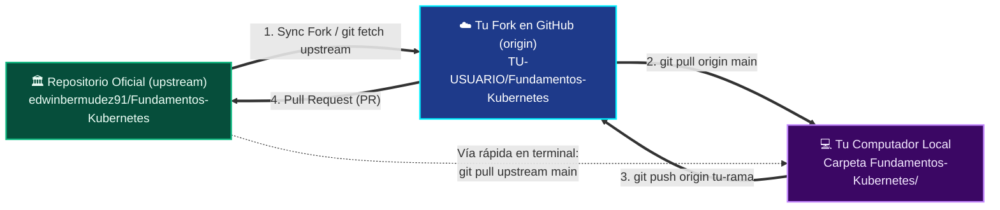
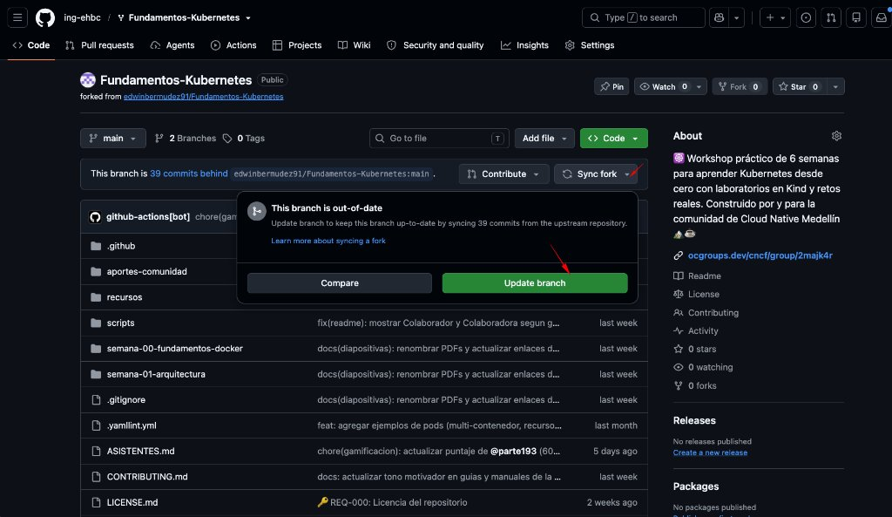

# 🔄 Cómo Mantener tu Fork Actualizado Semana a Semana (Sin Conflictos)

<div align="center">

[](https://docs.github.com/es/pull-requests/collaborating-with-pull-requests/working-with-forks/syncing-a-fork)
[](https://git-scm.com/book/es/v2/Fundamentos-de-Git-Trabajar-con-Remotos)

</div>

Cada semana publicamos nuevos laboratorios, diapositivas, mejoras en el simulador y nuevos **Retos Rotos** en el repositorio oficial (`edwinbermudez91/Fundamentos-Kubernetes`).

Si hiciste **Fork** en la Semana 00 o 01, tu copia personal no recibe los archivos nuevos automáticamente a menos que la **sincronices**. Aquí tienes las **2 formas oficiales** de hacerlo en menos de 1 minuto.

---

## 🗺️ Entendiendo el Mapa: `upstream` vs `origin` vs `Tu Computador`



---

## 🚀 Opción A: Desde el Navegador Web + 2 Comandos (La más fácil)

1. Abre en tu navegador **tu propio Fork** en GitHub:  
   `https://github.com/TU-USUARIO/Fundamentos-Kubernetes`
2. Debajo del botón verde **`<> Code`**, haz clic en el botón **`Sync fork`**.
3. Si aparece un botón verde que dice **`Update branch`**, haz clic en él. *(Si dice "This branch is not behind the upstream", significa que tu nube ya está al día).*

   <div align="center">

   

   </div>
4. Ahora abre la terminal en tu computador dentro de la carpeta `Fundamentos-Kubernetes` y descarga esos cambios a tu disco:

```bash
# 1. Pásate a la rama principal
git checkout main

# 2. Descarga las novedades desde tu Fork ya sincronizado
git pull origin main
```

¡Listo! Ya puedes crear tu rama para la nueva semana:
```bash
git checkout -b TU-USUARIO/semana-02
```

---

## ⚡ Opción B: 100% desde la Terminal con `upstream` (Flujo Open Source CNCF)

En proyectos Open Source de la CNCF y Kubernetes, los ingenieros conectan su computador directamente al repositorio original llamándolo **`upstream`**.

### Paso 1: Conecta el repositorio oficial como `upstream` *(Solo se hace una vez)*
```bash
git remote add upstream https://github.com/edwinbermudez91/Fundamentos-Kubernetes.git
```

Verifica que quedó conectado ejecutando `git remote -v`. Deberías ver dos direcciones:
- `origin` → apuntando a `TU-USUARIO/Fundamentos-Kubernetes.git`
- `upstream` → apuntando a `edwinbermudez91/Fundamentos-Kubernetes.git`

### Paso 2: Trae los cambios nuevos cada semana (4 comandos)
Cada vez que empiece una nueva semana del workshop, ejecuta:

```bash
# 1. Descarga las novedades del repositorio oficial
git fetch upstream

# 2. Asegúrate de estar en tu rama principal
git checkout main

# 3. Une los cambios oficiales sin crear commits basura (--ff-only)
git merge --ff-only upstream/main

# 4. Sube la actualización a tu propio Fork en GitHub
git push origin main
```

---

## 🛟 Solución de Problemas Frecuentes al Sincronizar

<details>
<summary><b>❌ Error: "Your local changes to the following files would be overwritten by merge"</b></summary>
<br>

Esto ocurre cuando modificaste algún archivo sin hacer commit o tocaste por accidente un archivo fuera de tu carpeta personal.

**Solución segura (guardando tu trabajo temporalmente en un cajón con `git stash`):**
```bash
# 1. Guarda tus cambios actuales en un cajón temporal
git stash

# 2. Descarga las novedades de la semana
git checkout main
git pull origin main

# 3. Crea tu rama de la semana y recupera tus archivos del cajón
git checkout -b TU-USUARIO/semana-02
git stash pop
```
</details>

<details>
<summary><b>❌ Error: "Not possible to fast-forward, aborting" al hacer `git merge --ff-only`</b></summary>
<br>

Esto pasa si hiciste commits directamente sobre tu rama `main` en lugar de crear una rama separada (`TU-USUARIO/semana-XX`).

**Solución:**
Si todos tus cambios importantes ya están guardados o dentro de tu carpeta `aportes-comunidad/soluciones-retos/TU-USUARIO/`, puedes alinear tu rama `main` exactamente con la oficial ejecutando:
```bash
git fetch upstream
git checkout main
git merge upstream/main
git push origin main
```
</details>

---

## 📚 Enlaces a la Documentación Oficial

* 🐙 **GitHub Docs:** [Sincronizar un Fork desde la web o línea de comandos](https://docs.github.com/es/pull-requests/collaborating-with-pull-requests/working-with-forks/syncing-a-fork) • [Configurar un repositorio remoto para un Fork](https://docs.github.com/es/pull-requests/collaborating-with-pull-requests/working-with-forks/configuring-a-remote-repository-for-a-fork)
* 🔧 **Pro Git Book (Español):** [Trabajar con Remotos (`origin` y `upstream`)](https://git-scm.com/book/es/v2/Fundamentos-de-Git-Trabajar-con-Remotos)

