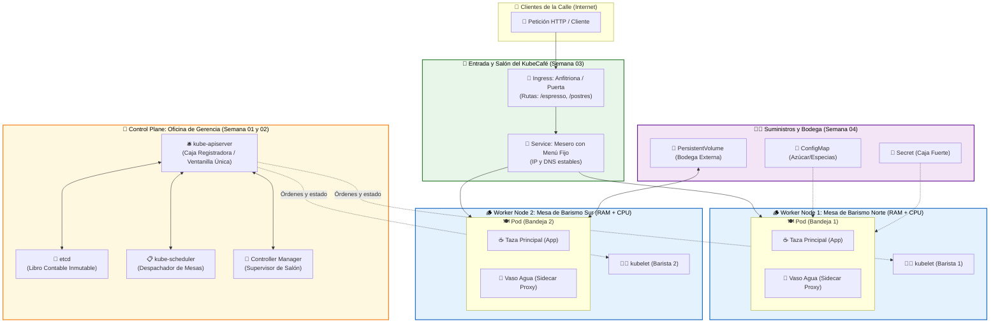
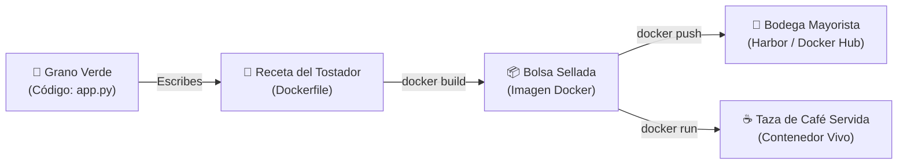
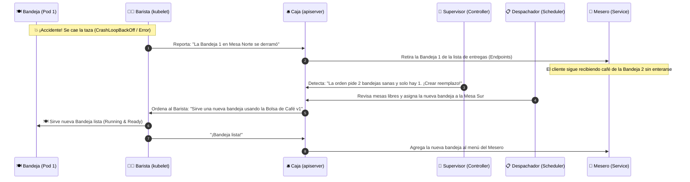

# ☕ Kubernetes explicado con la Analogía del Café (KubeCafé)
### De un Grano de Café (Semana 00) a una Franquicia Cloud Native (Semana 06)
**Cloud Native Medellín 🏔️☕**

Una guía intuitiva, visual e interactiva para comprender toda la arquitectura de **Docker** y **Kubernetes** comparándola con la operación de una cafetería de especialidad de alta escala: **KubeCafé**.

> [!TIP]
> **¿Cómo usar esta guía?**  
> Este documento es el **hilo conductor de todo el workshop (Semanas 00 a 06)**. Úsalo para traducir cualquier concepto técnico de Kubernetes a una situación real que puedes imaginar en segundos, y pon a prueba tu intuición con los **Retos Interactivos de Gerencia** al final.

---

## 📖 Antes de empezar: Palabras de la Cafetería en Lenguaje Cotidiano

En esta guía usamos algunos términos propios de las cafeterías y restaurantes que quizás no uses todos los días. Aquí tienes qué significa cada uno en palabras sencillas:

| Término en la historia | ¿Qué significa en la vida diaria? | ¿A qué representa en Kubernetes / Docker? |
| :--- | :--- | :--- |
| **👨‍🍳 Barista** | Es la **persona que prepara el café** detrás de la barra y maneja la máquina cafetera. | Representa al **`kubelet`**: el agente encargado dentro de cada servidor de encender y cuidar tus contenedores. |
| **🪵 Barismo / Mesa de barismo** | El *barismo* es el oficio de preparar buen café. Una **mesa de barismo** es el **mesón o estación de trabajo** donde están conectados los molinos y el agua para preparar las bebidas. | Representa a un **`Worker Node` (Nodo trabajador)**: el servidor físico o virtual que aporta **CPU** (molinos) y **RAM** (agua). |
| **📜 Tostador / Tostar y moler** | El café recién cosechado es un grano verde y duro. El **tostador** es quien lo cocina con calor (*tostar*) y lo tritura (*moler*) para que quede listo para colar. | Representa el proceso de **construir tu aplicación (`docker build`)** siguiendo las instrucciones del **`Dockerfile`**. |
| **🧾 Comanda** | En los restaurantes, es el **papelito u orden escrita** donde se anota exactamente qué pidió el cliente para pasarlo a la cocina. | Representa tu **archivo manifiesto `.yaml`** donde escribes qué quieres desplegar en el clúster. |
| **📦 Inmutable (Sellado al vacío)** | Significa que una vez cerrada la bolsa en la fábrica, **nadie puede abrirla para meterle ni quitarle nada**; si quieres otra mezcla, fabricas una bolsa nueva con otra etiqueta. | Así funcionan las **Imágenes de Docker**: nunca se editan por dentro; siempre se construye una versión nueva (`v1`, `v2`). |
| **🥛 Acompañante (*Sidecar*)** | En muchas cafeterías te sirven la taza de café acompañada de un **vasito de agua** en la misma bandeja. | Es un **contenedor secundario (*Sidecar*)** que vive dentro del mismo **`Pod`** (bandeja) para apoyar al contenedor principal (ej. enviar logs o cifrar tráfico). |
| **🚪 Anfitriona (*Hostess*)** | Es la persona en la **puerta de entrada del restaurante** que te da la bienvenida y te indica hacia qué salón o barra caminar según lo que vayas a pedir. | Representa al **`Ingress`**: la puerta de entrada de internet que dirige las peticiones web (`/pagos`, `/catalogo`) al servicio correcto. |

---

## 🧭 1. Tabla Maestra de Correspondencia Rápida (KubeCafé)

| Semana | Concepto Técnico | Analogía en KubeCafé | ¿Cuál es su función en la cafetería y en el clúster? |
| :---: | :--- | :--- | :--- |
| **S00** | **Código Fuente** | 🌱 Grano verde / crudo | Tu cosecha original y lógica de negocio (`app.py`, `index.html`). |
| **S00** | **Dockerfile** | 📜 Receta del tostador | Pasos exactos para tostar, moler y empacar el café. |
| **S00** | **Imagen Docker** | 📦 Bolsa de café sellada | Paquete inmutable y sellado al vacío, listo para distribuir en cualquier sucursal. |
| **S00** | **Registry (Harbor / Hub)** | 🏪 Bodega Mayorista | Catálogo central donde se almacenan, versionan y escanean las bolsas selladas. |
| **S00** | **Contenedor** | ☕ Taza de café servida | La bebida caliente, lista y ejecutándose en memoria/CPU. |
| **S01** | **Pod** | 🍽️ Bandeja de servicio | Unidad mínima que se lleva a la mesa: **taza de café principal** + **vaso de agua** (*Sidecar*). |
| **S01** | **Worker Node** | 🪵 Mesa de barismo | Estación física de trabajo equipada con agua (**RAM**) y molinos (**CPU**). |
| **S01** | **Kubelet** | 👨‍🍳 Barista de la mesa | Recibe órdenes de la gerencia, prepara la bandeja y vigila que las tazas no se enfríen. |
| **S01** | **Control Plane** | 🏢 Oficina de Gerencia | Coordina toda la cafetería sin preparar café directamente. |
| **S01** | **kube-apiserver** | 🛎️ Caja / Mostrador | Ventanilla única: todos los pedidos (`kubectl`) y reportes entran y salen por aquí. |
| **S01** | **etcd** | 📖 Libro contable | Registro absoluto, oficial e inmutable de todas las comandas, recetas y estado de las mesas. |
| **S01** | **kube-scheduler** | 📋 Despachador de mesas | Revisa qué mesa de barismo tiene molino (CPU) y agua (RAM) libre para asignar la bandeja. |
| **S01** | **Controller Manager** | 🧐 Supervisor de salón | Vigila que todo coincida con el libro contable; si una taza se derrama, ordena otra al instante. |
| **S02** | **Deployment y ReplicaSet** | 📝 Orden de Producción | *"Mantengan siempre 3 bandejas listas en barra"* y actualicen la receta sin cerrar el local (*Rolling Update*). |
| **S02** | **HPA (Autoscaler)** | 📈 Refuerzo de Hora Pico | Si la fila de clientes sube a las 7:00 a. m., multiplica las bandejas automáticamente de 3 a 10. |
| **S03** | **Service (`ClusterIP`)** | 🤵 Mesero de barra fija | Atiende a los clientes con un menú fijo y lleva el pedido a cualquier bandeja disponible y sana. |
| **S03** | **Ingress** | 🚪 Puerta y Anfitriona | Recibe a los clientes de la calle (`https://kubecafe.com`) y los guía según lo que pidan (`/frio`, `/postres`). |
| **S04** | **ConfigMap** | 🧂 Azúcar, canela y especias | Ajusta el sabor o las opciones del día sin tener que abrir ni volver a tostar la bolsa sellada. |
| **S04** | **Secret** | 🔐 Caja fuerte con llaves | Recetas secretas de la casa, claves del Wi-Fi y credenciales guardadas bajo llave. |
| **S04** | **Persistent Volume (PV/PVC)** | 🏬 Bodega externa | Sacos de café y registros permanentes que **no se pierden** aunque se caiga una taza o se cambie la mesa. |
| **S05** | **Probes (`Liveness/Readiness`)** | 🌡️ Termómetro de calidad | Comprueba si el café sigue caliente (`liveness`) y si la bandeja ya está completa para entregarse (`readiness`). |
| **S05** | **Resources y RBAC** | ⚖️ Dosificador y 🪪 Carnets | Cuánta agua/molino puede usar cada taza (`requests/limits`) y quién tiene permiso de entrar a Gerencia (`RBAC`). |
| **S06** | **Helm Chart** | 🍱 Kit de Franquicia | Plano maestro parametrizado para inaugurar una sucursal completa de KubeCafé en un solo comando. |

---

## 🏗️ 2. Diagrama de Arquitectura Completa (KubeCafé en Acción)

Observa cómo fluye todo dentro de **KubeCafé**: por un lado la **Oficina de Gerencia (`Control Plane`)** organiza las mesas; por otro, los **Clientes (`Tráfico HTTP`)** entran por la puerta principal (`Ingress`) y son atendidos por los meseros (`Service`) que toman las bandejas (`Pods`) preparadas por los baristas (`kubelet`):



---

## 🗺️ 3. La Historia Conectada Semana a Semana (Despliega cada Capítulo)

Haz clic en cada semana para descubrir cómo evoluciona nuestro negocio desde un grano de café casero hasta una franquicia automatizada:

<details open>
<summary><b>🐳 Semana 00 — El Tostador y la Receta (Fundamentos de Docker)</b></summary>
<br>

Antes de abrir una gran cafetería, necesitas estandarizar tu producto para que **nunca cambie de sabor** sin importar quién lo prepare:



1. **🌱 El Grano Verde (`Código Fuente`):** Es tu lógica en Python, Go, Node.js o HTML. Crudo no se puede tomar.
2. **📜 La Receta del Tostador (`Dockerfile`):** Define exactamente qué temperatura de agua usar (`FROM`), qué ingredientes mezclar (`COPY`, `RUN`), quién lo prepara sin quemarse (`USER no-root`) y cómo servirlo (`CMD`).
3. **📦 La Bolsa Sellada (`Imagen Docker`):** Cuando ejecutas `docker build`, empacas el café molido al vacío. Puedes enviar esa misma bolsa a Medellín, Bogotá o Tokio: **es inmutable**.
4. **☕ La Taza Servida (`Contenedor`):** Con `docker run`, abres la bolsa, pasas agua caliente y tienes una taza real humeando en la barra.

> 💡 **El límite de la Semana 00:** Sabes preparar una taza deliciosa en tu casa, pero ¿qué pasa si llegan 500 clientes al mismo tiempo y se te cae una taza? Necesitas contratar personal y abrir **KubeCafé (Kubernetes)**.
</details>

<details>
<summary><b>🌱 Semana 01 — Las Bandejas, las Mesas y la Gerencia (Arquitectura y Pods)</b></summary>
<br>

En **KubeCafé** está prohibido dejar tazas sueltas por ahí. Toda bebida se sirve en una **🍽️ Bandeja de Servicio (`Pod`)**:

* **🍽️ ¿Por qué una Bandeja (`Pod`) y no la taza sola?**  
  Porque un buen café de especialidad se sirve acompañado de un **🥛 vasito de agua con gas o una galleta (`Contenedor Sidecar`)**. Ambos van sobre la **misma bandeja (`misma IP / localhost`)**, comparten la misma servilleta (`volumen emptyDir`) y se entregan o retiran juntos.
* **🪵 Las Mesas de Barismo (`Worker Nodes`):**  
  Son las estaciones físicas donde trabajan los **👨‍🍳 Baristas (`kubelet`)**. Cada mesa tiene un límite de agua (**RAM**) y de molinos (**CPU**).
* **🏢 La Oficina de Gerencia (`Control Plane`):**  
  Cuando tú (`kubectl`) pides una bandeja:
  1. Entregas la comanda en la **🛎️ Caja Registradora (`kube-apiserver`)** (en **modo imperativo** dando la orden verbalmente con `k run`, o en **modo declarativo** entregando el formulario oficial impreso con `k apply -f`).
  2. La Caja la anota en el **📖 Libro Contable (`etcd`)**.
  3. El **📋 Despachador (`kube-scheduler`)** revisa qué mesa tiene espacio y asigna la tarea.
  4. El **👨‍🍳 Barista (`kubelet`)** de esa mesa abre la **📦 Bolsa de café (`Imagen`)** y sirve la **🍽️ Bandeja (`Pod`)**.
</details>

<details>
<summary><b>🔄 Semana 02 — El Supervisor y la Hora Pico (Deployments, ReplicaSets y Self-Healing)</b></summary>
<br>

Si creas una bandeja suelta (`Pod`) y alguien la tropieza, nadie prepara otra. Por eso en la Semana 02 contratamos al **🧐 Supervisor de Salón (`Controller Manager`)** mediante un **`Deployment`**:

* **📝 `Deployment` y `ReplicaSet`:** Dejas una orden permanente: *"Quiero que SIEMPRE haya 3 bandejas de Espresso listas"*.
* **⚡ Auto-Curación (*Self-Healing*):** Si una taza se derrama (`CrashLoopBackOff`) o una mesa entera se queda sin luz (`Node NotReady`), el Supervisor cuenta solo 2 bandejas y ordena preparar la 3.ª de inmediato en una mesa sana.
* **🔄 Cambio de Receta sin Cerrar (*Rolling Update*):** ¿Pasamos de *Café Origen Huila v1* a *Café Origen Antioquia v2*? El Supervisor va reemplazando bandeja por bandeja sin que ningún cliente se quede sin servicio. Y si el café v2 salió amargo, haces **`kubectl rollout undo`** (*Rollback*) y vuelves a la v1 en segundos.
</details>

<details>
<summary><b>🌐 Semana 03 — Los Meseros y la Anfitriona (Services e Ingress)</b></summary>
<br>

Las bandejas (`Pods`) son efímeras: cada vez que se sirve una nueva bandeja, tiene un número de ticket distinto (una IP distinta). ¡No puedes mandar a los clientes a meterse a la cocina a buscar qué bandeja está libre!

* **🤵 El Mesero de Barra Fija (`Service`):** Tiene una ubicación fija y conocida por todos. Recibe el pedido y lo toma de cualquiera de las bandejas listas (`Endpoints`) que tengan la etiqueta (`label`) correcta.
* **🚪 La Puerta y Anfitriona (`Ingress`):** Es la única entrada desde la calle (` puerto 80/443`). Si el cliente pide `kubecafe.com/calientes`, la Anfitriona llama al Mesero de Bebidas Calientes; si pide `kubecafe.com/postres`, lo dirige al Mesero de Repostería.
</details>

<details>
<summary><b>💾 Semana 04 — Azúcar, Recetas Secretas y Bodega (ConfigMaps, Secrets y PV)</b></summary>
<br>

¿Imaginas tener que volver a tostar y empacar miles de bolsas de café solo porque un cliente lo quiere con canela o leche de almendras?

* **🧂 `ConfigMap` (Azúcar y Especias en la mesa):** Inyecta variables de entorno o archivos de configuración al momento de servir la taza, manteniendo la **📦 Bolsa de café (`Imagen`)** intacta para cualquier ambiente (Desarrollo, QA, Producción).
* **🔐 `Secret` (La Caja Fuerte):** Guarda bajo llave las contraseñas de la base de datos, certificados TLS y tokens para que no estén escritos a la vista en los empaques.
* **🏬 `PersistentVolume` (PV / PVC — La Bodega Externa):** Si una bandeja se cae, el café de la taza se pierde, pero los sacos guardados en la **Bodega Externa** siguen intactos para cuando el nuevo barista prepare el reemplazo.
</details>

<details>
<summary><b>🛡️ Semana 05 — Control de Calidad, Dosificadores y Permisos (Probes, Recursos y RBAC)</b></summary>
<br>

Una cafetería profesional necesita estándares de calidad, control de costos y seguridad:

* **🌡️ Termómetros de Calidad (`Probes`):**
  * **`readinessProbe` (¿Ya está lista la bandeja?):** El mesero (`Service`) **no** se lleva la bandeja a la mesa del cliente hasta que el café haya terminado de filtrarse al 100%.
  * **`livenessProbe` (¿Sigue caliente el café?):** Si el café se enfrió o la máquina se trabó, el barista retira la taza y sirve una fresca automáticamente.
  * **`startupProbe` (Tiempo de precalentamiento):** Espera con paciencia mientras la máquina de espresso calienta el agua al inicio de la mañana.
* **⚖️ Dosificadores (`requests` y `limits`):** Garantizan que cada bandeja tenga su mínima agua asegurada (`requests`) y que ninguna taza desbordada gaste toda el agua de la mesa (`limits` / `OOMKilled`).
* **🪪 Carnets de Personal (`RBAC`):** El barista puede ver comandas de su mesa, pero solo el Gerente tiene llave para modificar el Libro Contable o borrar sucursales.
</details>

<details>
<summary><b>🚀 Semana 06 — El Kit de Franquicia (Helm y Proyecto Final)</b></summary>
<br>

KubeCafé fue un éxito rotundo en Medellín y ahora quieres abrir sucursales en Bogotá, Cali, Madrid y Ciudad de México. En lugar de copiar y pegar 25 hojas sueltas de YAML por cada ciudad, creas un **🍱 Kit de Franquicia (`Helm Chart`)**:

* **`Chart.yaml` y `templates/`:** Los planos arquitectónicos de la cafetería.
* **`values.yaml`:** La hoja de personalización por ciudad (en Medellín `replicas: 5`, en una sucursal pequeña `replicas: 2`).
* Con un solo comando (`helm install kubecafe-medellin ./kubecafe-chart`), inauguras toda la cafetería con sus mesas, meseros, bodega y seguridad listos.
</details>

---

## ⚡ 4. ¿Cómo funciona la Auto-Curación (*Self-Healing*) Paso a Paso?

Mira cómo reaccionan en equipo los personajes de **KubeCafé** cuando ocurre un accidente en producción:



1. **💥 El Accidente:** Una taza de café se cae al piso (`CrashLoopBackOff` o falla del contenedor).
2. **🧐 La Detección:** El **Supervisor de Salón (`Controller Manager`)** nota que el menú pide 3 tazas pero solo hay 2 tazas sanas en las mesas.
3. **📋 La Asignación:** El **Despachador (`kube-scheduler`)** revisa las mesas y asigna la preparación a la mesa que tenga molino y agua disponible.
4. **👨‍🍳 La Ejecución:** El **Barista (`kubelet`)** toma la bolsa de café (`Image`), sirve una nueva taza en una bandeja (`Pod`), y notifica a la caja (`kube-apiserver`).
5. **🤵 El Cliente:** Nunca se enteró de la caída porque el **Mesero (`Service`)** solo entrega tazas que pasaron la prueba de calidad (`readinessProbe`).

---

## 🎮 5. Trivia Interactiva: ¿Qué harías tú como Ingeniero de KubeCafé?

Pon a prueba lo que acabas de aprender. Lee cada situación, piensa tu respuesta y **haz clic en la tarjeta para revelar la solución técnica**:

<details>
<summary><b>🧩 Reto 1: "Si a las 7:00 a. m. llegan 10 veces más clientes a pedir café, ¿qué cambias primero: la receta (Dockerfile), la bolsa de café (Imagen) o la cantidad de bandejas (Pods)?"</b></summary>
<br>

✅ **Respuesta:** Aumentas **la cantidad de bandejas (`Pods`)** escalando tu `Deployment` (manualmente con `kubectl scale deployment kubecafe --replicas=10` o automáticamente con un **`HPA`**).  
No necesitas reescribir el código ni reconstruir la imagen de Docker solo porque haya más tráfico.
</details>

<details>
<summary><b>🧩 Reto 2: "El barista intenta preparar una bandeja, pero dice que la bolsa 'cafe-colombia:v99' no existe en la bodega mayorista. ¿Qué estado ves en kubectl?"</b></summary>
<br>

✅ **Respuesta:** Verás **`ErrImagePull`** o **`ImagePullBackOff`**.  
Significa que el `kubelet` (Barista) fue al Registry (Bodega Mayorista) a buscar la imagen indicada en tu YAML, pero el nombre o el tag están mal escritos o requieren credenciales (`imagePullSecrets`). Lo diagnosticas con:
```bash
kubectl describe pod <nombre-del-pod>
```
</details>

<details>
<summary><b>🧩 Reto 3: "Acabas de pedir una bandeja gigante que requiere 64 molinos de café (64 CPUs), pero tus mesas solo tienen 4 molinos cada una. ¿Qué pasa con tu pedido?"</b></summary>
<br>

✅ **Respuesta:** El Pod se queda en estado **`Pending` (Pendiente)** indefinidamente.  
El **📋 Despachador (`kube-scheduler`)** busca en todas las mesas (`Worker Nodes`), ve que ninguna tiene `64 CPUs` libres (`Insufficient cpu`) y deja la comanda en sala de espera hasta que ajustes los `resources.requests` o agregues una mesa más grande.
</details>

<details>
<summary><b>🧩 Reto 4: "Quieres que en Navidad todas las tazas salgan con un toque de canela (ENV SABOR_EXTRA=canela) sin volver a empaquetar las bolsas de café. ¿Qué objeto usas?"</b></summary>
<br>

✅ **Respuesta:** Usas un **`ConfigMap`** (🧂 Azúcar y especias).  
Desacoplas la configuración de la imagen de contenedor para que la misma bolsa sellada (`Imagen Docker`) sirva todo el año cambiando únicamente las variables inyectadas al Pod.
</details>

<details>
<summary><b>🧩 Reto 5: "El mesero (Service) está llevando a la mesa de los clientes tazas que apenas llevan agua tibia porque la cafetera tarda 20 segundos en calentar. ¿Cómo lo evitas?"</b></summary>
<br>

✅ **Respuesta:** Configuras una **`readinessProbe`** (🌡️ Termómetro de entrega) en el Pod.  
Así Kubernetes sabe que aunque el contenedor ya encendió (`Running`), aún **no está listo (`Ready: 0/1`)** para recibir clientes hasta que la sonda responda `200 OK`.
</details>

---

*Hecho con ❤️, ☕ y Kubernetes por la comunidad de **Cloud Native Medellín**.*
