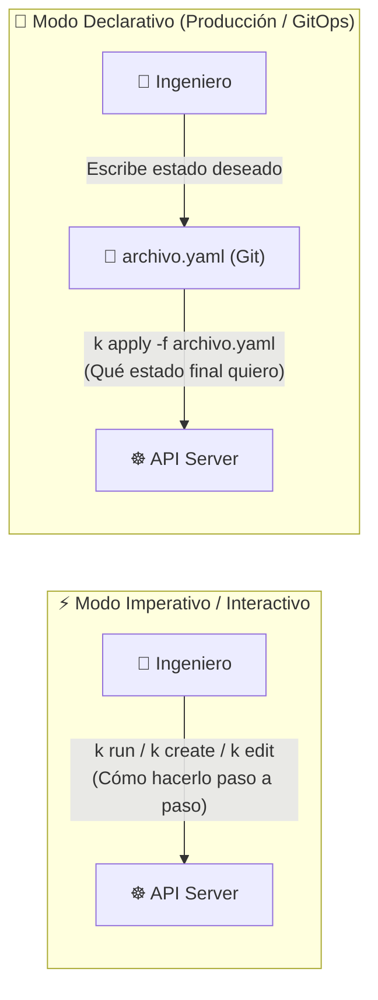
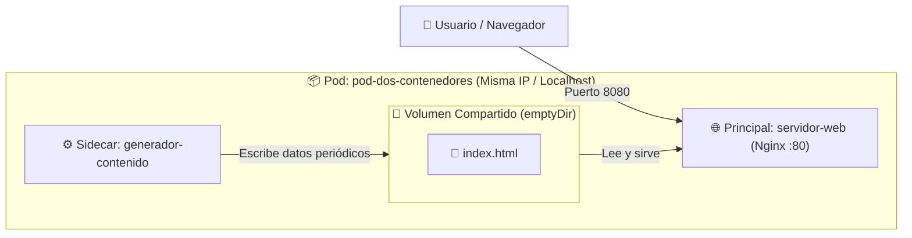

# 📂 Ejemplos Prácticos de Pods: Modo Imperativo vs. Declarativo (Semana 1)

En esta carpeta aprenderás las dos formas de trabajar con Kubernetes (**Modo Imperativo / Interactivo** y **Modo Declarativo**), los trucos de productividad en terminal (`--help`, `explain`, `--recursive`, `--dry-run`, exportación a archivos) y una colección progresiva de manifiestos YAML para dominar los **Pods**.

> [!TIP]
> En los ejemplos verás tanto `kubectl` como su alias corto **`k`** (`alias k=kubectl`). Ambos funcionan exactamente igual.

---

## 🧭 Índice Rápido

1. [⚖️ Modo Imperativo (Interactivo) vs. Modo Declarativo](#️-1-modo-imperativo-interactivo-vs-modo-declarativo)
2. [⚡ Creación Interactiva e Imperativa de Pods](#-2-creación-interactiva-e-imperativa-de-pods)
3. [🧪 Simulación con `--dry-run` y Exportación a YAML (`> file.yaml`)](#-3-simulación-con---dry-run-y-exportación-a-yaml--fileyaml)
4. [📖 Ayuda Integrada en Terminal: `--help`, `kubectl explain` y `--recursive`](#-4-ayuda-integrada-en-terminal---help-kubectl-explain-y---recursive)
5. [🔄 Ciclo de Vida con Manifiestos (`-f`): `apply`, `create`, `replace/edit` y `delete`](#-5-ciclo-de-vida-con-manifiestos--f-apply-create-replaceedit-y-delete)
6. [📑 Catálogo de Manifiestos YAML de Ejemplo](#-6-catálogo-de-manifiestos-yaml-de-ejemplo)
7. [🔍 Detalle del Pod con 2 Contenedores (Patrón Sidecar)](#-7-detalle-del-pod-con-2-contenedores-patrón-sidecar)

---

## ⚖️ 1. Modo Imperativo (Interactivo) vs. Modo Declarativo

En Kubernetes existen dos filosofías para crear y administrar recursos:



| Característica | ⚡ Modo Imperativo / Interactivo | 📜 Modo Declarativo |
| :--- | :--- | :--- |
| **¿Qué le dices a K8s?** | **Cómo** hacer algo mediante órdenes directas en la terminal. | **Qué** estado final deseas alcanzar descrito en un archivo `.yaml`. |
| **Comandos típicos** | `k run`, `k create`, `k expose`, `k scale`, `k edit`, `k delete pod X` | `k apply -f archivo.yaml`, `k diff -f archivo.yaml`, `k delete -f archivo.yaml` |
| **Trazabilidad / Auditoría** | ❌ Baja (si no guardas el comando, nadie sabe qué cambiaste). | ✅ Alta (el archivo YAML vive en Git con historial de commits y PRs). |
| **Idempotencia** | ❌ Si ejecutas `k run mi-pod` dos veces, la segunda vez falla (`AlreadyExists`). | ✅ Si ejecutas `k apply -f pod.yaml` 10 veces, K8s solo aplica cambios si los hay. |
| **¿Cuándo usarlo?** | Laboratorios rápidos, *troubleshooting* en vivo y exámenes (**CKA / CKAD**). | **Siempre en Producción**, ambientes compartidos, CI/CD y GitOps (ArgoCD/Flux). |

---

## ⚡ 2. Creación Interactiva e Imperativa de Pods

Sin escribir una sola línea de YAML, puedes pedirle a Kubernetes que cree Pods o abrir consolas interactivas dentro del clúster:

### A. Crear un Pod rápidamente desde la terminal (`k run`)
```bash
# Crear un Pod con Nginx exponiendo el puerto 80 y agregando etiquetas (labels):
k run pod-rapido --image=nginx:alpine --port=80 --labels="entorno=lab,semana=1"

# Verificar que está corriendo:
k get pods --show-labels
```

### B. Crear un Pod temporal e interactivo de diagnóstico (`--rm -it`)
¿Necesitas probar DNS, hacer un `curl` o un `ping` desde adentro de la red del clúster y que el Pod **se destruya automáticamente** apenas salgas de la terminal?
```bash
# Levanta un contenedor Busybox, abre una shell interactiva (-it) y lo borra al escribir 'exit' (--rm):
k run debug-red --rm -it --image=busybox:1.36 --restart=Never -- sh

# Dentro del Pod puedes probar:
# / # nslookup kubernetes.default
# / # wget -qO- http:// localhost (o IP de otro Pod)
# / # exit
```

### C. Ejecutar un comando único o abrir sesión interactiva en un Pod existente (`k exec`)
```bash
# 1. Ejecutar un comando puntual sin quedarte adentro (ej. ver la versión de Nginx o listar archivos):
k exec pod-rapido -- nginx -v
k exec pod-rapido -- ls -la /usr/share/nginx/html

# 2. Entrar de forma interactiva (-it) a la terminal del Pod:
k exec -it pod-rapido -- sh
```

---

## 🧪 3. Simulación con `--dry-run` y Exportación a YAML (`> file.yaml`)

> [!IMPORTANT]
> **El secreto de velocidad de los expertos:** Nunca escribas un archivo YAML desde cero en blanco. Usa el modo imperativo con `--dry-run=client -o yaml` para que `kubectl` te genere la plantilla perfecta y luego guárdala en un archivo con `>`.

### ¿Qué tipos de `--dry-run` existen?
1. **`--dry-run=client`:** Simula el comando **localmente en tu computador**. No envía nada al clúster (incluso funciona sin conexión al clúster). Ideal para generar plantillas YAML.
2. **`--dry-run=server`:** Envía la petición al **API Server** real para validar permisos RBAC, cuotas y *Admission Controllers*, pero **no guarda el objeto en `etcd`** (no crea el Pod de verdad). Ideal para validar si tu YAML será aceptado en producción.

### Ejemplos prácticos de `--dry-run` y redirección `> file.yaml`

```bash
# 1. Ver en pantalla cómo sería el YAML de un Pod sin crearlo en el clúster:
k run mi-servidor --image=nginx:alpine --port=80 --dry-run=client -o yaml

# 2. Exportar esa plantilla directamente a un archivo YAML listo para editar y versionar en Git:
k run mi-servidor --image=nginx:alpine --port=80 --dry-run=client -o yaml > mi-servidor-pod.yaml

# 3. Crear un Pod con variables de entorno y comando personalizado y guardarlo en archivo:
k run tarea-batch --image=busybox:1.36 --env="CIUDAD=Medellin" --dry-run=client -o yaml -- sh -c "echo Hola && sleep 3600" > tarea-batch.yaml

# 4. Validar contra el servidor si un archivo YAML existente tiene errores antes de aplicarlo:
k apply -f 01-mi-primer-pod.yaml --dry-run=server

# 5. Exportar el manifiesto completo de un Pod que YA está corriendo en el clúster a un archivo:
k get pod hola-medellin -o yaml > hola-medellin-backup.yaml
```

---

## 📖 4. Ayuda Integrada en Terminal: `--help`, `kubectl explain` y `--recursive`

¿Olvidaste cómo se escribe un comando o en qué nivel de indentación va `livenessProbe` o `resources` dentro de un Pod? **Kubernetes trae toda su documentación integrada dentro de `kubectl`.**

### A. `--help` (o `-h`): Ejemplos listos para copiar en cada comando
Cada subcomando de `kubectl` incluye docenas de ejemplos reales al ejecutar `--help`:
```bash
# Ver todos los ejemplos oficiales de cómo usar 'kubectl run':
k run --help

# Ver opciones y ejemplos de 'apply', 'create' o 'delete':
k apply --help
k create --help
```

### B. `kubectl explain`: El diccionario interactivo de manifiestos YAML
`kubectl explain` consulta el esquema OpenAPI de tu clúster y te explica qué hace cada campo, si es obligatorio (`required`) y qué tipo de dato recibe (`string`, `integer`, `Object`, `[]Object`):

```bash
# 1. Explicar la estructura raíz de un Pod (apiVersion, kind, metadata, spec, status):
k explain pod

# 2. Navegar hacia adentro usando puntos (.) igual que en el árbol YAML:
k explain pod.spec
k explain pod.spec.containers
k explain pod.spec.containers.ports
k explain pod.spec.containers.livenessProbe
k explain pod.spec.containers.resources
```

### C. `kubectl explain <recurso> --recursive`: Ver el árbol completo de campos
Si no recuerdas cómo se llama un campo ni dónde está ubicado, agrega **`--recursive`** para imprimir toda la jerarquía de propiedades del recurso:

```bash
# 1. Ver absolutamente todos los campos posibles que existen dentro de un Pod:
k explain pod --recursive

# 2. Ver solo el árbol de campos dentro de 'pod.spec.containers':
k explain pod.spec.containers --recursive

# 3. Truco Ninja: Combinar '--recursive' con 'grep' para buscar un campo por palabra clave:
k explain pod.spec --recursive | grep -i -C 3 "probe"
```

---

## 🔄 5. Ciclo de Vida con Manifiestos (`-f`): `apply`, `create`, `replace/edit` y `delete`

La bandera **`-f`** (`--filename`) le indica a `kubectl` que lea uno o varios archivos YAML (o incluso un directorio entero o una URL).

### Resumen de comandos sobre archivos (`-f`)

| Acción | Comando | ¿Qué hace exactamente? |
| :--- | :--- | :--- |
| **Aplicar (Crear o Actualizar)** | `k apply -f archivo.yaml` | **Estándar Declarativo.** Si el recurso no existe, lo crea; si ya existe, calcula las diferencias y aplica solo el cambio. |
| **Crear (Estricto)** | `k create -f archivo.yaml` | **Imperativo con archivo.** Crea el recurso desde el YAML, pero **da error** si el objeto ya existe en el clúster. |
| **Comparar antes de actualizar** | `k diff -f archivo.yaml` | Muestra en pantalla qué líneas cambiarían en el clúster si ejecutaras `k apply -f`. |
| **Actualizar / Reemplazar** | `k replace -f archivo.yaml` | Sustituye el objeto vivo por la definición completa del archivo (requiere que el objeto ya exista). |
| **Recrear forzosamente** | `k replace --force -f archivo.yaml` | Borra el Pod y lo vuelve a crear de inmediato (muy útil porque muchos campos de un Pod son inmutables tras crearse). |
| **Actualizar en caliente** | `k edit pod <nombre>` o `k set image...` | Abre el YAML vivo en tu editor (`vim`/`nano`) o actualiza un campo puntual sin tocar tu archivo local. |
| **Eliminar** | `k delete -f archivo.yaml` | Borra del clúster únicamente los recursos que están definidos dentro de ese archivo `.yaml`. |

### 💻 Laboratorio Paso a Paso: Crear, Actualizar y Eliminar con `-f`

Ejecuta estos comandos desde la carpeta `semana-01-arquitectura/1.ejemplos/`:

```bash
# 1. CREAR / APLICAR en modo declarativo:
k apply -f 01-mi-primer-pod.yaml

# (Si intentas usar 'k create -f 01-mi-primer-pod.yaml' ahora, verás el error AlreadyExists,
# mientras que 'k apply -f 01-mi-primer-pod.yaml' te dirá 'unchanged' sin fallar).

# 2. ACTUALIZAR (Update) el Pod:
# Opción A (Declarativa - Recomendada): Agregar una etiqueta o cambiar la imagen y volver a aplicar:
k label -f 01-mi-primer-pod.yaml ambiente=desarrollo --overwrite
k apply -f 01-mi-primer-pod.yaml

# Opción B (Actualizar la imagen de un contenedor en vivo de forma imperativa):
k set image pod/hola-medellin servidor-web=nginx:1.27-alpine

# Opción C (Editar el YAML en vivo desde la terminal):
k edit pod hola-medellin

# Opción D (Si cambiaste un campo inmutable en tu archivo YAML local, recréalo con replace --force):
k replace --force -f 01-mi-primer-pod.yaml

# 3. ELIMINAR el recurso usando el mismo manifiesto:
k delete -f 01-mi-primer-pod.yaml

# (O aplicar / eliminar TODOS los manifiestos de una carpeta de un solo golpe):
k apply -f .
k delete -f .
```

---

## 📑 6. Catálogo de Manifiestos YAML de Ejemplo

| Archivo | Tipo de Pod | Concepto Clave |
| :--- | :--- | :--- |
| [`01-mi-primer-pod.yaml`](./01-mi-primer-pod.yaml) | Pod Básico (1 Contenedor) | Estructura básica mínima de un Pod en Kubernetes. |
| [`02-pod-multi-contenedor.yaml`](./02-pod-multi-contenedor.yaml) | **Multi-Contenedor (2 Contenedores)** | Patrón Sidecar con volumen temporal compartido (`emptyDir`). |
| [`03-pod-con-recursos-y-env.yaml`](./03-pod-con-recursos-y-env.yaml) | Pod con Variables y Recursos | `requests`, `limits` de CPU/RAM y Downward API (`fieldRef`). |
| [`04-pod-con-init-container.yaml`](./04-pod-con-init-container.yaml) | Pod con `initContainers` | Tareas previas bloqueantes antes de iniciar la app principal. |
| [`05-pod-con-health-checks.yaml`](./05-pod-con-health-checks.yaml) | Pod con Sondas de Salud | `readinessProbe` y `livenessProbe` para auto-recuperación. |

---

## 🔍 7. Detalle del Pod con 2 Contenedores (Patrón Sidecar)

El archivo [`02-pod-multi-contenedor.yaml`](./02-pod-multi-contenedor.yaml) implementa un Pod con **dos contenedores** que colaboran estrechamente:

1. **`servidor-web` (Nginx):** Sirve tráfico HTTP en el puerto 80 desde la ruta `/usr/share/nginx/html`.
2. **`generador-contenido` (Busybox - Sidecar):** Ejecuta un bucle cada 5 segundos que actualiza un archivo `index.html` en la ruta `/datos`.



### ¿Qué comparten dos contenedores en el mismo Pod?
* **Red:** Comparten la misma dirección IP y el espacio de red. Pueden comunicarse entre sí usando `localhost:<puerto>`. (⚠️ **Ojo:** No pueden escuchar en el mismo puerto).
* **Almacenamiento:** Mediante volúmenes de tipo `emptyDir`, pueden leer y escribir en el mismo directorio del sistema de archivos.
* **Ciclo de vida:** Son programados juntos en el mismo Worker Node y mueren juntos.

---

### 🚀 Comandos Útiles para Interactuar con el Pod Multi-Contenedor

#### 1. Aplicar el manifiesto
```bash
k apply -f 02-pod-multi-contenedor.yaml
```

#### 2. Ver el estado de los contenedores
Observa la columna `READY` (marcará `2/2` cuando ambos contenedores estén listos):
```bash
k get pods
```

#### 3. Ver logs de un contenedor específico (`-c`)
Cuando un Pod tiene más de un contenedor, debes especificar el contenedor con `-c`:
```bash
# Logs del servidor web:
k logs pod-dos-contenedores -c servidor-web

# Logs o salida del contenedor generador:
k logs pod-dos-contenedores -c generador-contenido
```

#### 4. Entrar a la terminal de un contenedor específico
```bash
k exec -it pod-dos-contenedores -c servidor-web -- sh
```

#### 5. Probar el resultado en tu navegador
```bash
k port-forward pod/pod-dos-contenedores 8080:80
```
Abre en tu navegador **[http://localhost:8080](http://localhost:8080)** y refresca cada pocos segundos para ver la fecha/hora actualizarse dinámicamente.
